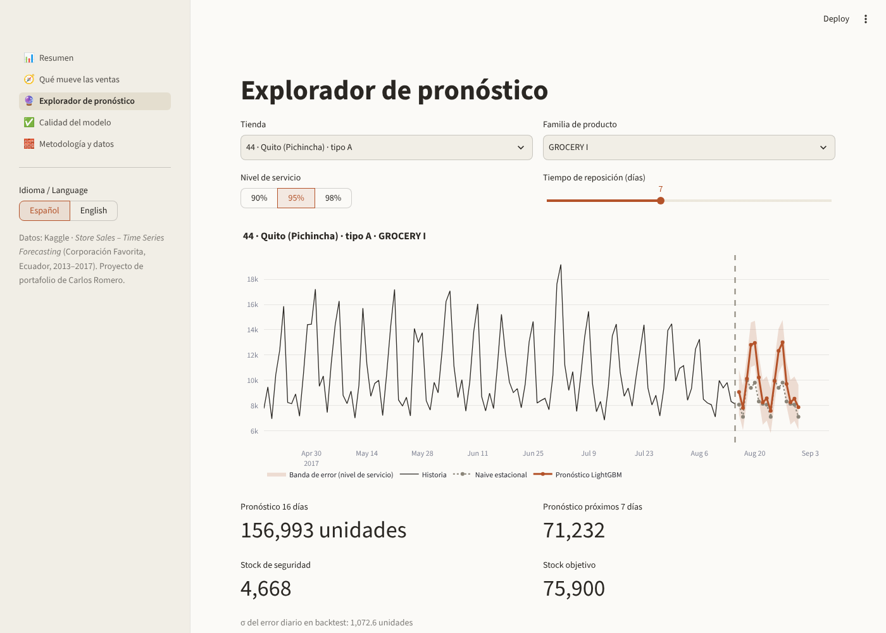
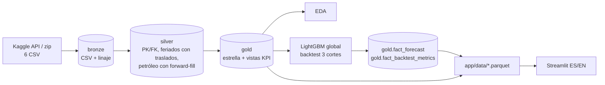
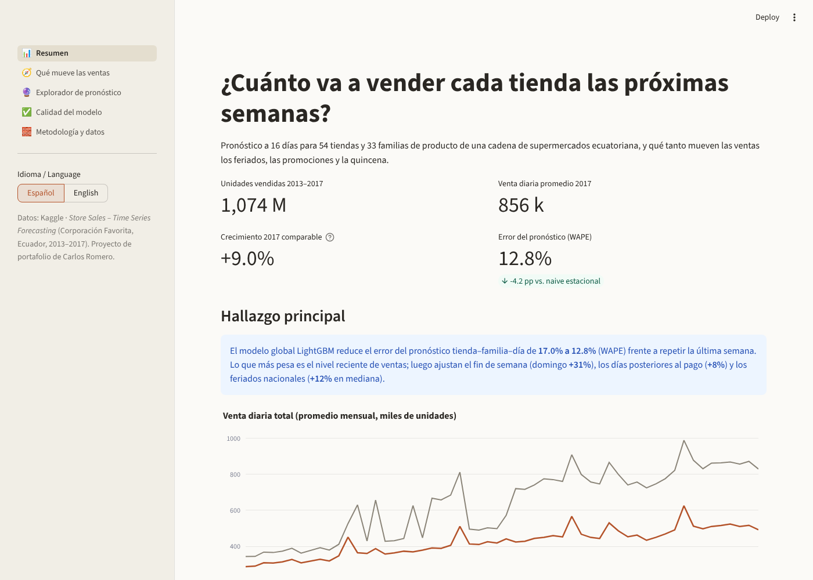
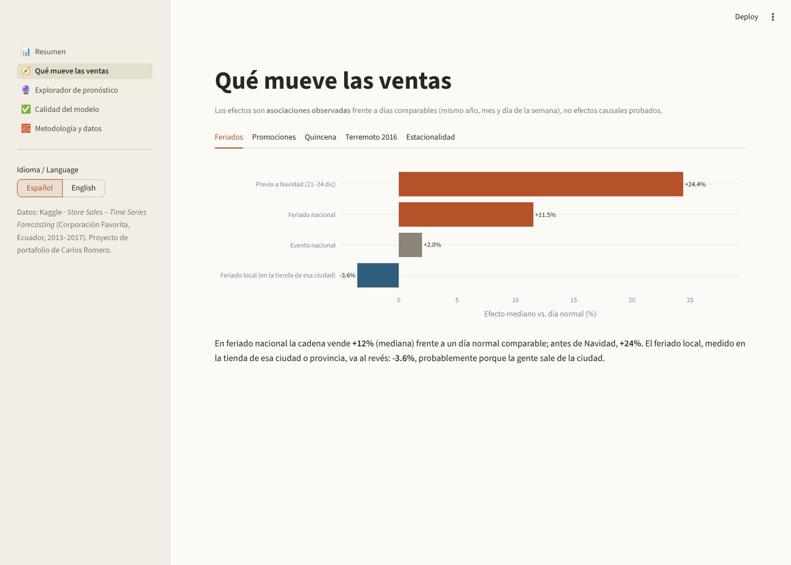
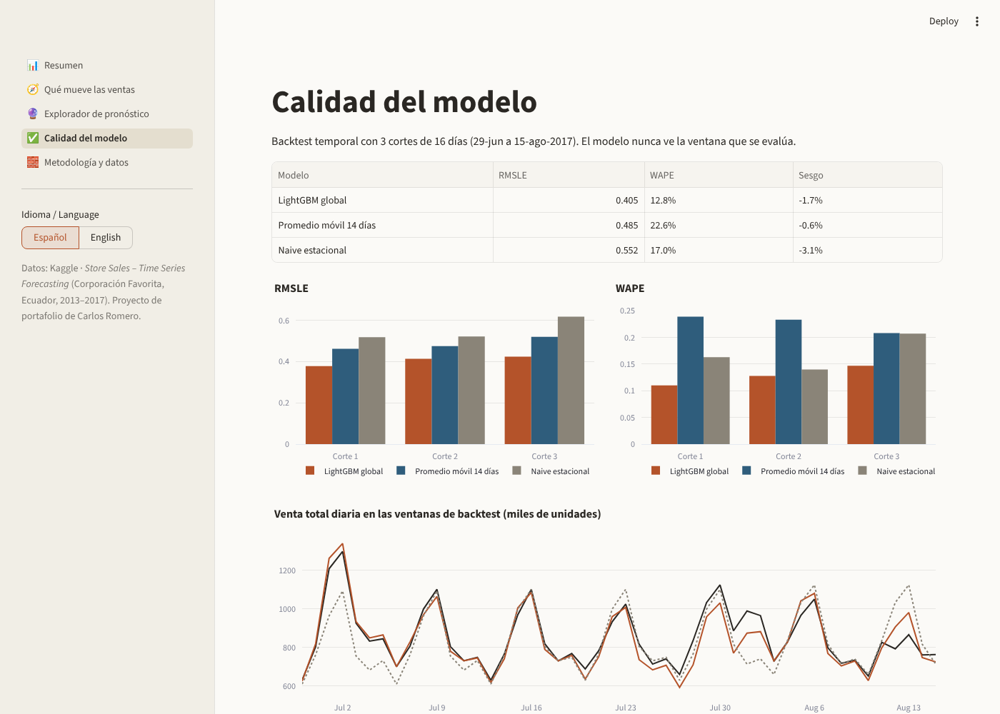

# 🛒 Favorita Demand Forecast

**¿Cuánto va a vender cada tienda de un supermercado ecuatoriano las próximas semanas, y qué tanto mueven las ventas los feriados, las promociones y la quincena?**

Pronóstico de demanda a 16 días para las **54 tiendas y 33 familias de producto** de Corporación Favorita (Ecuador), con 3 millones de registros diarios reales (2013–2017). El proyecto cubre un pipeline de datos Medallion con pruebas de calidad, EDA con efectos de calendario, un modelo LightGBM global validado en el tiempo y una app bilingüe con recomendación de inventario.

🔗 **App:** APP_URL_PENDIENTE · 📓 [EDA](notebooks/01_eda.ipynb) · 📓 [Modelo](notebooks/02_model.ipynb) · 📄 [Hallazgos](docs/insights.md)



## Resultados

| Modelo (backtest, 3 cortes de 16 días) | RMSLE | WAPE | Sesgo |
|---|---:|---:|---:|
| **LightGBM global** | **0.405** | **12.8%** | −1.7% |
| Naive estacional (repetir la última semana) | 0.552 | 17.0% | −3.1% |
| Promedio móvil 14 días | 0.485 | 22.6% | −0.6% |

El modelo reduce el WAPE en una cuarta parte, gana en los 3 cortes y en 32 de 33 familias. El total diario de la cadena se equivoca 4.5%.

## Hallazgos principales
*(Asociaciones observadas frente a días comparables, no efectos causales probados. Detalle en [docs/insights.md](docs/insights.md).)*

1. **Quincena:** el día de pago no vende más, pero los días 1–3 posteriores venden **+8%**.
2. **Feriados:** nacional **+12%** (mediana); local **−3.6%** en la tienda de esa ciudad, porque la gente sale.
3. **Promociones:** la comparación ingenua de GROCERY I sugiere +121%; dentro de la misma tienda y mes es **+6.5%** (+9% ponderado en todas las familias). Correlación ≠ causalidad.
4. **Fin de semana y diciembre:** domingo **+31%**, diciembre **+32%**.
5. **Terremoto 2016:** las tiendas de Manabí y Esmeraldas vendieron **+40%** en las 4 semanas siguientes, frente a +6% en la misma ventana de 2015.
6. **Calidad de datos:** antes de julio de 2015 hay meses sin registrar (PRODUCE casi en cero). Detectarlo cambió un crecimiento aparente de +33% en 2016 por uno comparable de **+10%** ([ADR 0004](docs/adr/0004-registro-incompleto-antes-de-2015.md)).

## Arquitectura



- **Motor:** DuckDB (archivo local) con esquemas `bronze`, `silver` y `gold`. Los scripts **T-SQL** equivalentes para SQL Server (`MERGE`, `CREATE OR ALTER`) están en `sql/00`–`03` ([ADR 0001](docs/adr/0001-duckdb-en-lugar-de-sql-server.md)).
- **Gold:** `fact_sales` (3,000,888 filas, grano fecha–tienda–familia), `dim_date` (quincena, feriados, petróleo), `dim_store`, `dim_family`, `fact_forecast`, `fact_backtest_metrics`, la vista `v_store_holiday` y vistas de KPI. Ver el [diagrama ER](docs/er_diagram.md).
- **Calidad:** 8 pruebas en verde y pipeline idempotente ([reporte](docs/data_quality_report.md)).

## Stack
Python 3.11+ · DuckDB · SQL (T-SQL) · pandas · LightGBM · SHAP · Plotly · Streamlit · pytest · Git (una rama por fase).

## Cómo ejecutarlo

```bash
git clone https://github.com/CarlosRomero55/favorita-demand-forecast.git
cd favorita-demand-forecast
python -m venv .venv && source .venv/bin/activate   # Windows: .venv\Scripts\activate
pip install -r requirements.txt

# Datos: API de Kaggle (requiere ~/.kaggle/kaggle.json y aceptar las reglas) o el zip oficial
python -m src.download                      # o: python -m src.download --zip store-sales-time-series-forecasting.zip

python -m src.pipeline --twice              # bronze → silver → gold + calidad + prueba de idempotencia (~2 min)
python -m src.model                         # backtest, modelo final, pronóstico y submission.csv (~3 min)
python -m src.export_snapshot               # resúmenes para la app
pytest -q                                   # 24 pruebas
streamlit run app/streamlit_app.py
```

Para publicar la app, ver [docs/deploy_streamlit.md](docs/deploy_streamlit.md).

## Estructura

```
sql/            T-SQL para SQL Server (00–03) y SQL de DuckDB (sql/duckdb)
src/            download, load_bronze, build_silver, build_gold, quality, analysis, features, model, inventory, export_snapshot, pipeline
notebooks/      01_eda.ipynb, 02_model.ipynb (ejecutados, con conclusiones)
app/            streamlit_app.py, i18n.py, pages/, data/ (snapshot < 5 MB por archivo)
docs/           plan, ER, calidad, model card, hallazgos, despliegue, LinkedIn, guía de estudio, ADR
tests/          pruebas de configuración, DDL, pipeline, modelo y app
```

## Capturas

| Resumen | Qué mueve las ventas | Calidad del modelo |
|---|---|---|
|  |  |  |

## Limitaciones
- Validación en verano de 2017: no incluye diciembre ni feriados nacionales grandes.
- Los efectos de promociones y feriados son asociaciones, no causalidad.
- Todo está en unidades, no en dólares (el dataset no trae precios).
- Las series intermitentes (BOOKS, BABY CARE) se pronostican mal.
- La recomendación de inventario es una **heurística didáctica** (z × σ × √L), no la política real de Favorita.
- Los scripts T-SQL están escritos pero no se ejecutaron contra un SQL Server en este entorno.

Más detalle en el [model card](docs/model_card.md).

## Fuente y términos
Datos de la competencia de Kaggle [*Store Sales – Time Series Forecasting*](https://www.kaggle.com/competitions/store-sales-time-series-forecasting), usados según sus [reglas](https://www.kaggle.com/competitions/store-sales-time-series-forecasting/rules). Los CSV **no** se redistribuyen en este repositorio.

> Alexis Cook, DanB, inversion, Ryan Holbrook. (2021). *Store Sales - Time Series Forecasting*. Kaggle.

---
Carlos Romero · Ingeniero en TI · BI, Ciencia de Datos y Automatización · Guayaquil, Ecuador
