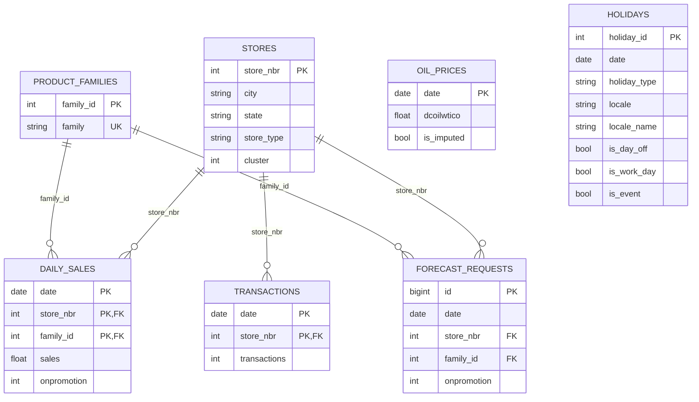
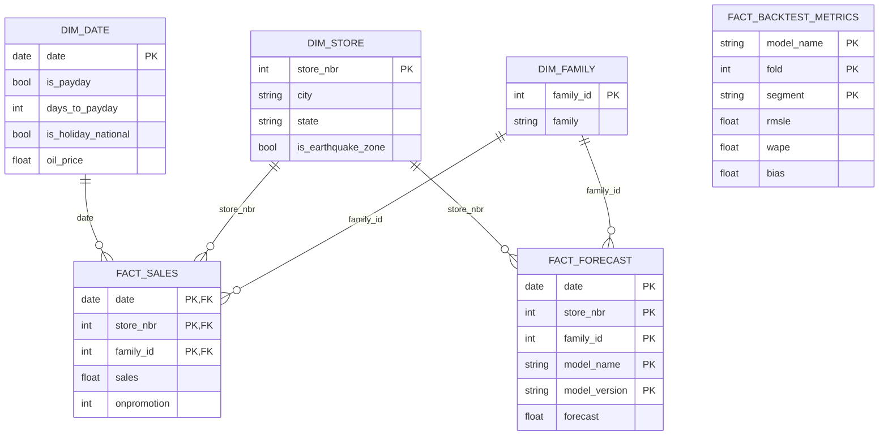

# Diagrama entidad–relación

## Silver

## Gold (modelo estrella)

Vistas: `gold.v_store_holiday` (feriado nacional, regional o local que aplica a cada tienda), `gold.v_kpi_daily`, `gold.v_kpi_yearly`, `gold.v_kpi_family` y `gold.v_kpi_store`.
