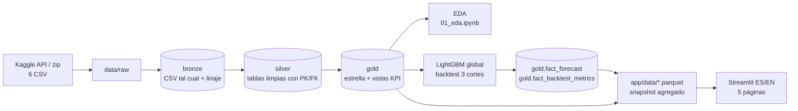

# Plan del proyecto · Favorita Demand Forecast

## Pregunta gancho
¿Cuánto va a vender cada tienda de un supermercado ecuatoriano las próximas semanas, y qué tanto mueven las ventas los feriados, las promociones y la quincena?

## Preguntas de negocio
1. ¿Cómo evolucionan las ventas totales entre 2013 y 2017 y cuánto crecen año a año?
2. ¿Qué patrón semanal, mensual y anual tienen las ventas? ¿Cuánto pesa diciembre?
3. ¿Cuánto cambian las ventas en feriados nacionales y locales frente a un día normal?
4. ¿Qué familias muestran mayor asociación entre promociones y ventas?
5. ¿Se nota la quincena (días 15 y último del mes, pago del sector público) en las ventas?
6. ¿Cómo afectó el terremoto del 16-abr-2016 a las tiendas de Manabí y Esmeraldas frente al resto?
7. ¿Qué tan exacto es un pronóstico a 16 días por tienda y familia frente a un método ingenuo?
8. ¿Cuánto stock debería tener cada tienda–familia según el nivel de servicio deseado?

## KPIs
| KPI | Fórmula |
|---|---|
| Ventas totales | Σ sales en el periodo |
| Crecimiento interanual | (ventas año t / ventas año t−1) − 1 |
| Lift de promoción % | (venta media tienda–familia–día con promoción / venta media sin promoción) − 1, calculado dentro de cada familia |
| Efecto feriado % | (venta media diaria total en feriado / venta media en días normales del mismo día de semana) − 1 |
| Efecto quincena % | (venta media diaria en días de pago y el siguiente / venta media del resto de días) − 1 |
| WAPE | Σ\|real − pronóstico\| / Σ real |
| RMSLE | √( media( (log(1+pronóstico) − log(1+real))² ) ) — métrica oficial de la competencia |
| Sesgo | Σ(pronóstico − real) / Σ real (positivo = sobrepronóstico) |

> Los efectos de promociones, feriados y quincena son **asociaciones observadas**, no efectos causales probados.

## Arquitectura

Motor: DuckDB local (ver ADR 0001), con scripts T-SQL equivalentes en `sql/` para SQL Server.

## Fases y ramas
| Fase | Rama |
|---|---|
| Setup y plan | `feat/setup` |
| Base de datos (DDL) | `feat/database` |
| Ingesta y calidad | `feat/ingesta` |
| EDA | `feat/eda` |
| Modelo y snapshot | `feat/modelo` |
| App Streamlit | `feat/app` |
| Cierre | `docs/cierre` |
